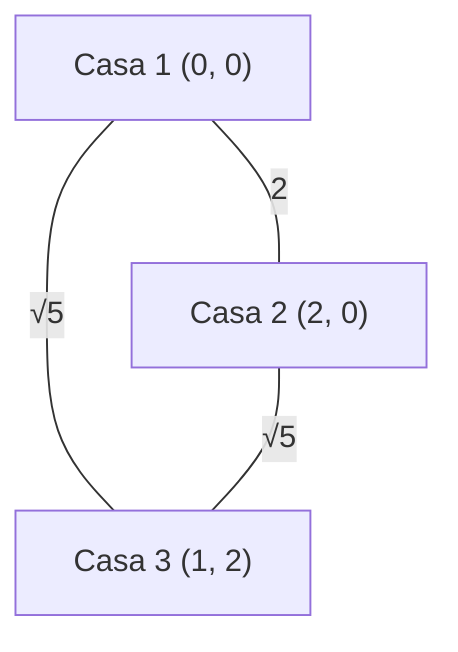

# Marco 2 — Escolha do algoritmo: Treehouses

**Disciplina:** Resolução de Problemas com Grafos  
**Problema:** [Treehouses — Kattis](https://open.kattis.com/problems/treehouses)  
**Classe:** Árvore Geradora Mínima (MST)  
**Enunciado:** [T3 — Ricardo Carubbi](https://github.com/carubbi/RPG/blob/main/mat-didatico/trabalhos/T3.md)

**Algoritmo:** Kruskal com Union-Find

### 2.1 Algoritmo escolhido e justificativa

O algoritmo escolhido foi **Kruskal**, pois ele resolve o problema da Árvore Geradora Mínima selecionando conexões de menor peso entre componentes que ainda estão separadas.

A estratégia prevista para o Treehouses é:

1. Registrar as coordenadas de todas as casas.
2. Inicializar uma estrutura **Union-Find**, responsável por identificar os grupos de casas já conectados.
3. Unir inicialmente as casas com acesso por terra (de `1` até `e`) e os pares ligados pelos `p` cabos existentes, pois não exigem novos cabos.
4. Calcular os comprimentos de todas as possíveis novas ligações entre pares de casas, utilizando a distância euclidiana.
5. Ordenar essas ligações do menor para o maior comprimento.
6. Percorrer a lista ordenada, acrescentando uma ligação apenas quando suas extremidades pertencem a componentes diferentes, e somar seu comprimento ao custo total.
7. Encerrar quando todas as casas estiverem na mesma componente.

**Justificativa da escolha:** o Kruskal favorece as conexões mais curtas sem criar ciclos desnecessários. O Union-Find permite verificar quais casas já se comunicam, inclusive por caminhos indiretos ou ligações existentes. Assim, o algoritmo utiliza apenas os cabos adicionais necessários para conectar toda a rede com comprimento mínimo.

### 2.2 Representação de uma instância pequena

Foi escolhido o **primeiro exemplo oficial (Sample Input 1)** do Kattis.

**Entrada:**

```text
3 1 0
0.0 0.0
2.0 0.0
1.0 2.0
```

A primeira linha indica `n = 3` casas, `e = 1` casa com acesso por terra e `p = 0` cabos já instalados.

| Casa | Coordenadas | Acesso inicial |
|---|---|---|
| 1 | `(0.0, 0.0)` | Por terra |
| 2 | `(2.0, 0.0)` | Sem conexão inicial |
| 3 | `(1.0, 2.0)` | Sem conexão inicial |

O grafo possui três vértices e três possíveis arestas. Os pesos são os comprimentos das ligações:

| Ligação possível | Cálculo da distância | Comprimento aproximado |
|---|---|---:|
| 1–2 | `√((2−0)² + (0−0)²)` | `2.000000` |
| 1–3 | `√((1−0)² + (2−0)²)` | `2.236068` |
| 2–3 | `√((1−2)² + (2−0)²)` | `2.236068` |

**Representação gráfica da instância:**



O diagrama mostra **todas as ligações possíveis**, não cabos que já estejam instalados. Neste exemplo, nenhuma ligação por cabo existe inicialmente.

### 2.3 Validação da entrada e saída esperada

**Saída oficial do exemplo no Kattis:**

```text
4.236067
```

A menor ligação é a da casa **1 à casa 2**, com comprimento `2`. Em seguida, para conectar a casa 3, pode-se utilizar **1–3** ou **2–3**, ambas com comprimento `√5`. Escolhendo 1–3, por exemplo, temos:

$$
L_{\min}=d(1,2)+d(1,3)=2+\sqrt{5}
$$

$$
L_{\min}\approx4.236067977\ldots
$$

O resultado é compatível com a saída oficial `4.236067`, dentro da tolerância aceita. Não é necessário instalar a terceira ligação, pois as três casas já ficam conectadas com apenas duas arestas. Como existe empate entre 1–3 e 2–3, ambas as escolhas levam ao mesmo comprimento mínimo.

Essa validação é **teórica, baseada no exemplo e no resultado esperado**; a execução da implementação adaptada e os testes completos serão documentados nos marcos posteriores.

### 2.4 Complexidade de pior caso — Tempo

Se `V` é o número de casas, todas as ligações diretas possíveis formam um grafo completo com:

$$
E=\frac{V(V-1)}{2}=O(V^2)
$$

Na abordagem escolhida, os custos principais são:

| Operação | Complexidade de tempo |
|---|---|
| Gerar e calcular as possíveis novas arestas | `O(V²)` |
| Ordenar as `E` arestas pelo comprimento | `O(E log E)` |
| Verificar/unir componentes com Union-Find otimizado | `O(E · α(V))` no total |

A função `α(V)` é a inversa da função de Ackermann e cresce extremamente devagar. Dessa forma, **a ordenação domina a complexidade total**.

Como `E = O(V²)`, temos:

$$
O(E\log E)=O(V^2\log(V^2))=O(V^2\log V)
$$

**Complexidade de tempo no pior caso: `O(V² log V)`.**

### 2.5 Complexidade de pior caso — Espaço

A implementação precisa armazenar:

- Até `E = O(V²)` arestas, cada uma com as duas extremidades e seu comprimento;
- As coordenadas das `V` casas: `O(V)`;
- A estrutura Union-Find: `O(V)`;
- Até `V−1` arestas da solução, caso se opte por registrá-las: `O(V)`.

Como o maior consumo está no armazenamento das possíveis ligações:

$$
O(V^2)+O(V)=O(V^2)
$$

**Complexidade de espaço no pior caso: `O(V²)`.**

Essas complexidades correspondem à implementação de Kruskal que **gera e armazena todas as ligações possíveis** antes de ordená-las.

### 2.6 Síntese da escolha

O Kruskal foi selecionado porque minimiza o comprimento total dos cabos adicionados, respeitando os acessos e as conexões que já existem. No primeiro exemplo oficial do Kattis, a escolha de duas ligações resulta em um comprimento mínimo de aproximadamente `4.236068`, compatível com a saída esperada. Para a abordagem escolhida, a complexidade no pior caso é **`O(V² log V)` em tempo** e **`O(V²)` em espaço**.
